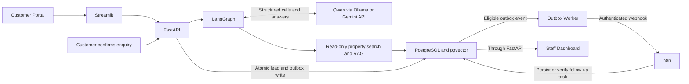
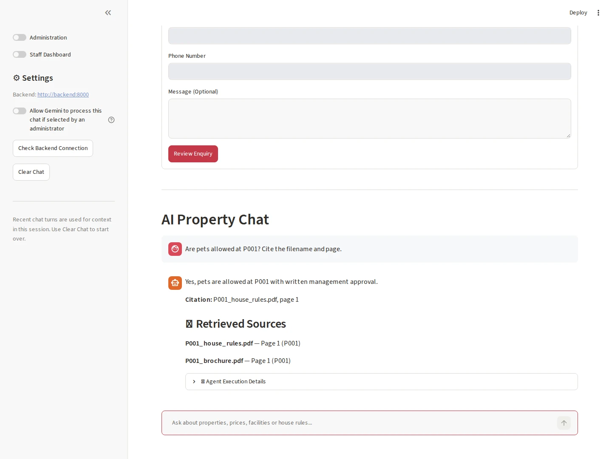

# AI Property Agent

A local real-estate enquiry system with natural-language property search, PDF-grounded answers, and a staff follow-up workflow. It demonstrates how an AI assistant can answer listing questions while keeping customer submissions and employee actions in an auditable application workflow.

## Key features

- **Property search and tool calling** use structured filters and backend validation. Search defaults to available listings.
- **Property-specific RAG** uses BGE-M3 embeddings and pgvector to find evidence within one property's PDFs. Answers cite verified filenames and page numbers.
- **Local and cloud generation** supports Qwen3.5:4B via Ollama and optional Gemini 3.5 Flash-Lite. Administrators control the global provider. Cloud chat requires customer consent.
- **Authorized ingestion** supports individual property creation and CSV preview and confirmation with validation and audit records.
- **Human-confirmed enquiries** atomically create a lead, confirmation record, and outbox event. A worker delivers an authenticated webhook to n8n, which creates an idempotent internal follow-up task.
- **Staff operations** cover leads, task status changes, and delivery monitoring.

## Architecture



The language model can read property facts and evidence through tools. FastAPI owns confirmed lead writes, and n8n invokes the database function that creates follow-up tasks.

**Stack** · Python 3.12, FastAPI, Pydantic, LangGraph, Streamlit, Ollama, PostgreSQL, pgvector, SQLAlchemy, Alembic, n8n, Docker Compose and pytest. [Architecture](docs/ARCHITECTURE.md) · [Technical decisions](docs/TECHNICAL_DECISIONS.md)

## Evaluation

| Metric | Qwen3.5:4B, each of three runs | Gemini 3.5 Flash-Lite, resumed |
|---|---:|---:|
| Answer accuracy | 44/44 | 44/44 |
| Strict task success | 43/44 | 41/44 |
| HTTP success for final recorded outcomes | 44/44 | 44/44 |
| Property precision / recall | 28/28 / 28/28 | 28/28 / 28/28 |
| Returned citation validity | 12/12 | 12/12 |

Gemini completed the 44 fixed synthetic cases by resuming a checkpoint. Earlier HTTP 429 and 503 failures remain documented. The final HTTP score measures the selected outcome for each case. [Evaluation report](evaluation/REPORT.md) · [Model comparison](evaluation/MODEL_COMPARISON.md)

## Quick start

Install Docker Engine with Compose v2 and Ollama. From the repository root:

```bash
ollama pull qwen3.5:4b
ollama pull bge-m3
(umask 077; cp -n .env.example .env.compose)
```

Set private demo-only values in `.env.compose`, then follow the [local demo](docs/DEMO.md). It explains how to start the isolated Compose services, load synthetic data, verify citations, confirm an enquiry, deliver the webhook, and complete the follow-up as staff.

## Screenshots



See all eight [browser screenshots](assets/README.md), including the staff dashboard, lead management, follow-up tasks, automation monitoring and administrator model settings.

## Limitations

- The stack is a local portfolio demo with synthetic Malaysian listings and PDFs. Production deployment, automatic customer messages and arbitrary PDF uploads are outside its scope.
- Gemini requires separate credentials and Google project quota. Qwen is the default.
- The fixed benchmark measures behavior on this dataset. Semantic scores were not independently reviewed.
- Two historical webhook failures remained in the internal development Sandbox. The public demo starts with a fresh database and excludes those records.

[Implementation status](docs/IMPLEMENTATION_STATUS.md)

## License

No open-source license has been applied. MIT is proposed for owner-approved project material. [Proposed licensing scope](docs/LICENSE_REVIEW.md)
