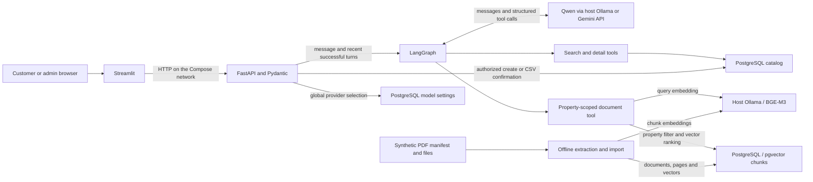
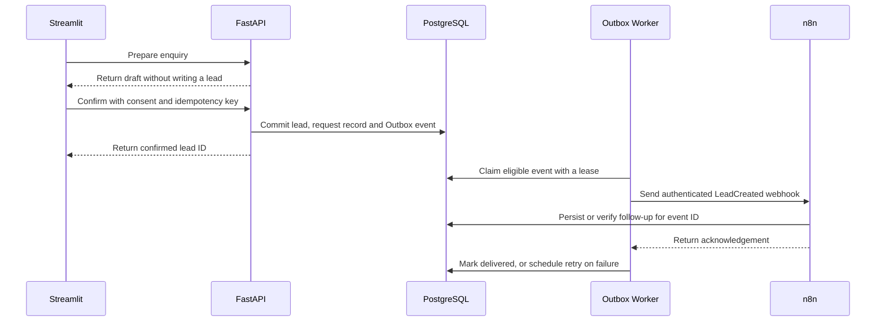
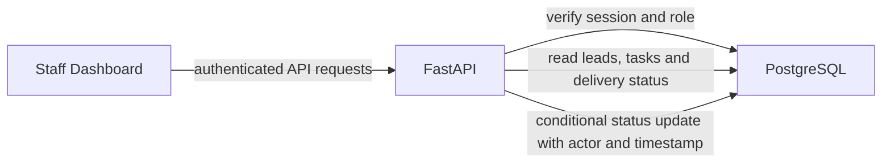

# Architecture

## Request and evidence flow

Streamlit calls `http://backend:8000` from its container. FastAPI and the worker use `postgres:5432`. Host access to the UI, API, and n8n is bound to loopback. Alembic runs as a one-shot Compose service before backend startup. PostgreSQL and n8n each use a named volume. Ollama runs on the host.

For `POST /agent/chat`, FastAPI forwards the supplied recent conversation to LangGraph. The graph binds `search_properties`, `get_property_details`, and `search_documents`. The backend constrains availability from the current user request and validates tool arguments before querying. A malformed call can be repaired once. Tool errors and missing evidence have distinct responses. The chat tools have no write operation.

The offline import extracts text from the bundled PDFs and keeps document IDs, property IDs, filenames, and page numbers with the chunks. BGE-M3 produces 1,024-dimensional vectors. The PostgreSQL retriever scopes by property before similarity ranking. FastAPI validates citation metadata and returns structured sources alongside the answer.

## Enquiry and follow-up

The worker uses row locking with `SKIP LOCKED` for claims, performs HTTP outside the claim transaction, and uses the current lease to finalize a delivery. It backs off on a failed attempt and can reclaim an expired lease. The webhook uses header authentication. n8n calls a dedicated PostgreSQL function that creates or verifies the follow-up task before acknowledging it. The event ID is unique on the task, so redelivery can safely recover from a lost acknowledgement.

## Employee operations

The dashboard reuses database-backed sessions. STAFF and ADMIN can access staff endpoints, and ADMIN retains exclusive access to property ingestion and global provider selection. A task update succeeds only when the row still has the expected starting status.

## Database records and access

| Records | Responsibility |
|---|---|
| `properties` | Validated, synthetic listing catalog. Availability is part of the stored record. |
| `documents`, `document_chunks` | PDF metadata, property association, source pages and vector embeddings. |
| `leads`, `lead_requests` | The confirmed enquiry and its idempotency record. A repeated confirmation resolves to the original lead. |
| `outbox_events` | Durable delivery state, attempt count, retry schedule and worker lease. |
| `follow_up_tasks` | One internal task per delivered event, with staff status and latest actor. |
| `admin_accounts`, `admin_sessions`, `admin_audit` | Role identities, revocable sessions and administrative audit records. |
| `model_settings` | The global provider preference. Qwen is the default. Gemini activation requires a successful synthetic tool probe. |

The customer agent uses read-only property tools. Staff and administrators use role-checked sessions for employee operations. Only administrators can add catalog records and change the global provider. The cloud path requires customer consent before sending conversation context. RAG limits results to the requested property before ranking.

Local development uses Docker Compose with a dedicated portfolio project. Backend, migration, frontend, worker, PostgreSQL and n8n use the Compose network. Application ports bind to loopback and the database and n8n use separate project-owned volumes. The host supplies Ollama. [Setup and verification](DEMO.md)
